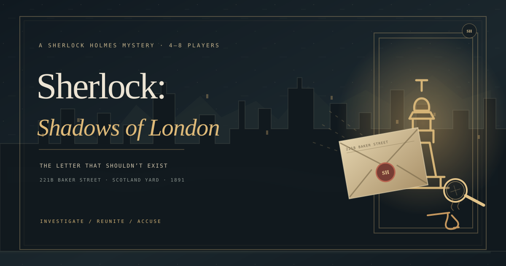

# Sherlock: Shadows of London

An original Sherlock Holmes browser mystery for 2–8 human players. Join Watson’s circle at 221B Baker Street and trace a forged letter through London. Two or three players solve it as a team; four or more add one hidden culprit. Play three rounds and compare scores.



## Play locally

Requires Node.js 24 or newer.

```sh
npm ci
npm run dev:local
```

Open `http://localhost:3000`. Create a room, then have one to seven friends enter its six-character room code from their own devices. This local preview keeps rooms in memory while the server runs. The Vercel deployment stores rooms in Upstash Redis so separate function instances share the same game state. There are no accounts, downloads, bots, or fake players.

## Rules

- In the waiting room, every connected player has a **Ready** button. The game starts automatically once at least two players are connected and everyone is ready; any player can change their status before that.
- Move with WASD or the arrow keys. On a phone, use the touch pad beneath the map.
- Stand by a glowing station and press **E** or **Investigate**.
- **2–3 players:** everyone is a detective. Work together; there is no culprit or suspect vote.
- **4–8 players:** one person is secretly the culprit. The culprit can strike a nearby detective or jam a mission station. A struck detective can be rescued, or recovers after 18 seconds.
- Compare the letter at Scotland Yard, decode Holmes’s timetable at 221B Baker Street, then repair the East London telegraph. Different detectives handle paired evidence fragments.
- In a 4–8 player case, two clues unlock one suspicion vote. Every detective names one suspect. A unanimous vote takes the culprit out of the case; a wrong or split vote lets them continue.
- After the telegraph, everyone still in the chase must reach Blackthorn Safehouse. Stand together at the door and investigate to finish the case. There is no second accusation round.
- Play three rounds. Detectives earn +1 per evidence fragment they record, +1 for reaching the safehouse, +2 for solving the case, and +3 for a correct culprit vote. The culprit earns +1 per different station jammed, +2 for jamming two stations, and +2 for escaping capture. Highest total after round three wins; ties share the win. The host can open the next round from results, then everyone readies again.

## Deploy to Vercel

The Vercel Function at `/api/game` stores each room in Upstash Redis. Redis is necessary because Vercel Functions can run on separate instances; in-memory room state would not reliably be shared between players. The Redis script performs room updates atomically, so simultaneous joins and actions do not overwrite newer state.

1. Extract `sherlock-game.zip` and open a terminal in the extracted `sherlock-game` folder.
2. Install Node.js 24, then run `npm ci`.
3. Install the Vercel CLI once with `npm install --global vercel`, then run `vercel login` and `vercel link`. Follow the prompts to create or select your Vercel project.
4. In the Vercel dashboard, open the project’s **Storage** page and create an **Upstash Redis** database. Connect it to the project and enable it for Preview and Production. Vercel injects the `UPSTASH_REDIS_REST_URL` and `UPSTASH_REDIS_REST_TOKEN` environment variables.
5. Run `npm run deploy:preview`. Open the preview URL and visit `/api/game`; it should return `{"ok":true,"storage":"connected"}`. Test a room with two separate browser windows.
6. When the preview works, run `npm run deploy:production`.

The source ZIP is for Vercel CLI or Git deployment; it is not a prebuilt static-only upload. Vercel builds the function and serves `public/` as the site. Do not put Redis credentials in source files. The project in this workspace is not linked to a Vercel account, so I could not make a live deployment or verify the hosted Redis connection here.

## Build and package checks

```sh
npm run test:game
npm run build
npm run test:room-cap
```

After linking Vercel and connecting Upstash, run `npm run dev` to exercise the deployed function shape locally.

The simulation covers the Ready gate, full co-op and deduction rounds, clue sequence, voting, rescue, sabotage, cooldowns, recovery, reunion, secret-role privacy, and rematches. `npm run test:game` also checks the Vercel API health route and atomic Redis-style updates. `npm run test:room-cap` exercises the local HTTP server. `npm run build` checks the Vercel files and browser API path.

